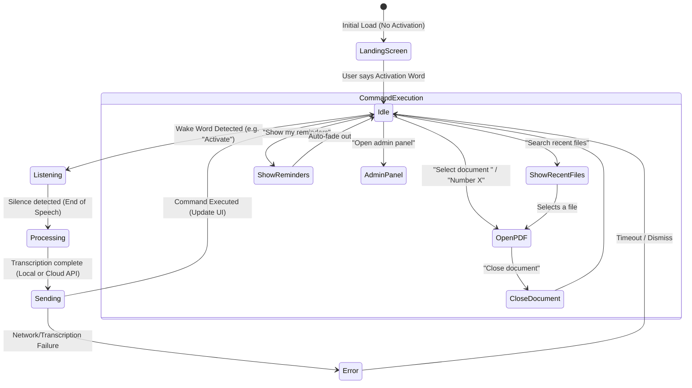
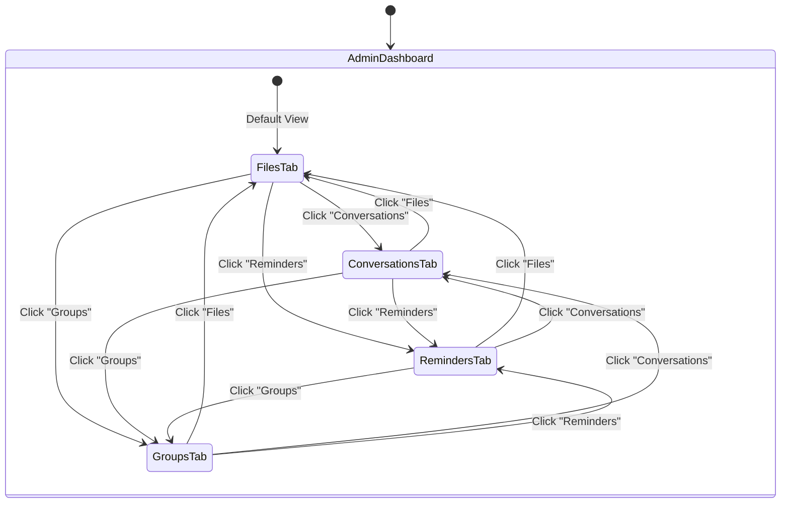
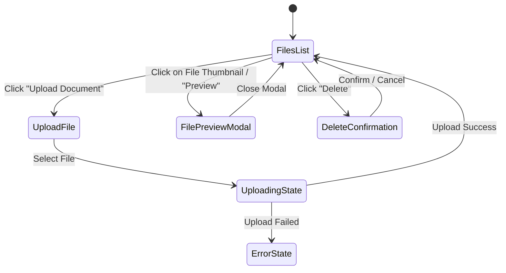
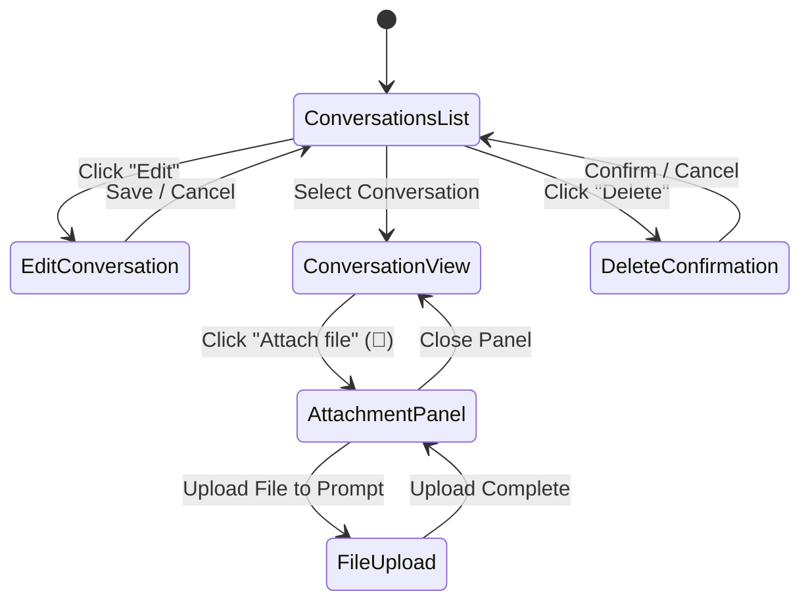
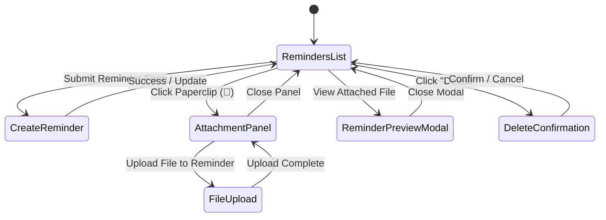
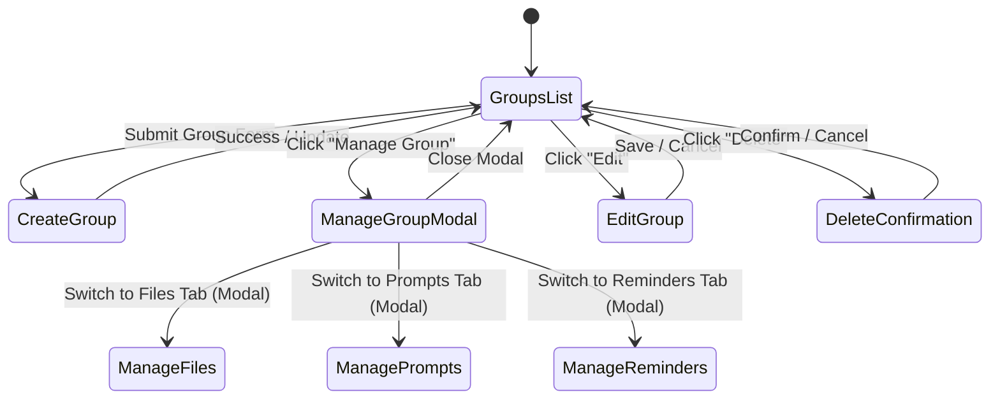

# Smart Glasses Middleware - Transition Diagrams

This document contains Mermaid.js state transition diagrams that model the different main sections (referred to as pages) and features of the project: Voice Interface, Files, Conversations (Prompts), Reminders, and Groups.

## System Overview

The application is split into two primary front-end interfaces:
1. **The Voice Client (`App.jsx`)**: The primary interface on the smart glasses, handling voice activation, listening, processing, and rendering documents/reminders.
2. **The Admin Panel (`admin.html`)**: A web-based dashboard used to manage files, conversations, reminders, and groups.

---

## 1. Voice Interface (Smart Glasses Client)

This diagram shows the state transitions of the voice pipeline managed in `App.jsx`, including handling wake words and command execution (e.g., opening files, showing reminders).

---

## 2. Admin Panel Navigation

The Admin Panel operates as a Single Page Application (SPA) where the "pages" are represented as top-level tabs.

---

## 3. Files Tab

Transitions and interactions within the **Files** section.

---

## 4. Conversations (Prompts) Tab

Transitions and interactions within the **Conversations** section.

---

## 5. Reminders Tab

Transitions and interactions within the **Reminders** section.

---

## 6. Groups Tab

Transitions and interactions within the **Groups** section. Used to group multiple resources (Prompts, Files, and Reminders) together.

